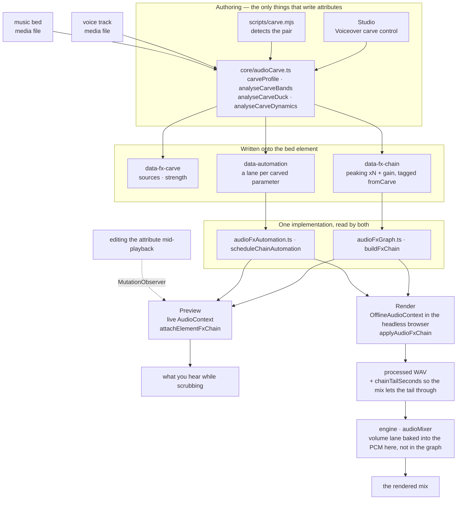
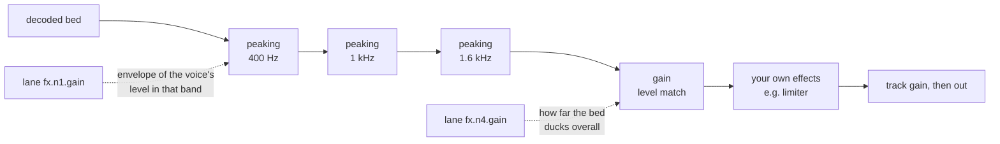

<!-- ===== FILE: hyperframes/hyperframes-audio/GUIDE.md ===== -->

---
name: hyperframes-audio
description: >
  Use when audio already placed in a HyperFrames composition needs to be mixed:
  fade-in/fade-out, crossfade, track gain or volume, volume automation, ducking,
  a music bed that fights a voiceover (voiceover carve), effects on a track
  (EQ, compressor, limiter, gate, saturation, delay, reverb, chorus, phaser,
  bitcrush), automation envelopes drawn on a track's volume or any effect
  parameter, or one submix bus carrying a chain, a fader and an automation clock
  for several tracks at once (`<hf-audio-group>`).
  Don't use for sourcing or generating audio — finding BGM, SFX, or making a
  voiceover is `/media-use`. Don't use for clip timing or track layout, which is
  `/hyperframes-core`.
---

**Plugin installs:** Before setup or freshness commands, follow [plugin execution rules](../hyperframes/references/plugin-installation.md) when this skill is inside a HyperFrames plugin. Standalone installs keep the update instructions below.

# HyperFrames Audio

A mix is a set of relationships, not a stack of processors. Two tracks that each
sound right alone can be unlistenable together, and the fix is almost never "turn
one down" — it is finding what they are fighting over and giving it to whichever
one needs it. Every tool here exists to express one of those relationships.

Effects live on the element as `data-fx-chain`, and preview and render run the
same Web Audio graph — the studio in a live context, the engine in an offline one
inside the browser it already drives. There is one implementation of each effect,
so what you hear while scrubbing is what gets written. You never tune twice.

Clip timing remains `/hyperframes-core`: audio/video trims and source ranges use
`data-start`, `data-duration`, and `data-media-start`, and crossfades overlap
clips on different tracks. This skill owns placed-track fade-in/fade-out,
crossfade envelopes, track gain/track volume, volume and effect automation,
ducking/voiceover carve, and the effect chain. `/media-use` owns sourcing,
generation, and preprocessing.

Constant `data-playback-rate` (`0.1..10`) is render-safe for picture and
pitch-preserved sound when matching audio/video elements use the same timing,
source offset, and rate. A speed ramp is a `rate` lane in `data-automation`
(see `docs/reference/speed-ramps`); it wins over the constant and keeps pitch
in preview and render. HyperFrames does not
provide automatic waveform sync or drift correction.
For copyable cut/crossfade/retime recipes, use `/hyperframes-core` → `references/creator-editing-recipes.md`.

Three attributes carry everything, on the audio/video element itself — or, for
the first two, on an `<hf-audio-group>` bus (see "One bus for many tracks"):

| Attribute         | Holds                                                     |
| ----------------- | --------------------------------------------------------- |
| `data-fx-chain`   | the effects, in signal order                              |
| `data-automation` | envelopes on this track's volume or its effect parameters |
| `data-fx-carve`   | the carve's own settings, so it can be re-derived         |

The shipped effect families are gain, EQ (highpass, lowpass, peaking, shelves),
compressor, limiter, truepeak (lookahead true-peak limiter), gate, saturate, delay, reverb, chorus, phaser, and bitcrush.

Exact JSON for each, and the rules a lane must satisfy: `references/attributes.md`.
Every effect with its parameters, ranges and units: `references/fx-registry.md`.
How to work out what is wrong with a file you cannot hear:
`references/diagnosis.md`.
**Presets, named jobs and one-knob profiles, plus a symptom-to-fix table:
`references/presets.md`** — read that before hand-building a chain, because one
of the presets or named jobs usually already names the problem.

## How it fits together

Two authoring surfaces write those attributes; two runtimes read them through the
same builders. That shared middle is why preview predicts the render.



The carve's own settings are never read at playback — the chain and lanes it
produced are what play. `data-fx-carve` exists so strength can be changed on an
existing carve instead of guessed back out of the filters.

Inside a carved bed the signal runs through the dips first, then the level match,
then anything you built yourself — which is why a limiter you add still acts as
the last ceiling:



## First, work out what is wrong

The table below starts from "it sounds boomy" — which presumes somebody already
listened and said so. Handed a file and "fix this", you have no such sentence
and you cannot listen, so you have to measure. One rule governs all of it:

> **The absolute spectrum of a single unknown voice cannot be diagnosed.**
> Formants are ±10 dB, fundamentals run 85–255 Hz, and sentences decline 5–6 dB
> as they end. Every one of those reads as a defect on its own, and every one of
> them is the speaker.

So compare, and compare against something **inside the same file**: the clean
original if it exists, otherwise the pauses — whatever is audible in a gap is
additive, and the gap's spectrum is the channel rather than the voice. Comparing
against a published average spectrum or a synthesised control voice does not
work: two speakers differ by more than most defects, and both wrong answers in
the evaluation behind this guidance came from exactly that.

When there is no original and no usable silence, a static tonal defect is
genuinely under-determined. Say so and offer the readings that fit, rather than
picking one and building a chain on it.

Commands, traps and worked recipes: **`references/diagnosis.md`**. Read it
before diagnosing a file nobody has described.

## Start from the symptom

Once you know the band and the kind, name what is wrong with the audio. Most bad audio is
one or two of these, and each has a shipped answer:

| It sounds like                     | Reach for                                          |
| ---------------------------------- | -------------------------------------------------- |
| Hum or thump underneath            | `rumble-cut`, or a `highpass` at 80 Hz             |
| Boomy, chesty                      | **Tame Boominess** job (200 Hz)                    |
| Muffled, behind cardboard          | **Reduce Mud** job (250 Hz)                        |
| Words hard to make out             | **Add Clarity** job (3 kHz), or carve the bed      |
| Harsh and tiring                   | **Soften Harshness** job (3.2 kHz)                 |
| Some words much louder than others | **Evenness** on a compressor, or Even Out Levels   |
| Room tone between sentences        | `room-gate`                                        |
| Voice and music fighting           | **Voiceover carve** — not an EQ on either          |
| Dry, recorded nowhere              | `room-tight` or `room-natural`                     |
| Just "amateur"                     | `voice-clean`, which is four of the above in order |

Full catalogue, what each preset contains, the band vocabulary, and what is
deliberately NOT covered (de-essing, noise removal, tone match):
`references/presets.md`.

Subtract before you add, level after you filter, relationships after level,
character and ceiling last. Each step changes what the next one hears — a
compressor set before a high-pass spends its time chasing rumble.

## Reach for a family by the problem, not the name

**Filters** (`highpass`, `lowpass`, `peaking`, `lowshelf`, `highshelf`) decide
which frequencies a track is allowed to occupy. This is the first tool for two
sources colliding, because collisions happen in bands: a bed and a voice both
want 1–3 kHz, and taking that from the bed costs the bed far less than turning
the whole thing down costs the mix. A high-pass on a voice is the standard fix
for rumble; a low-pass darkens or muffles deliberately.

**Dynamics** (`gain`, `compressor`, `limiter`, `truepeak`, `gate`) decide how a track's level
behaves over time. Compression narrows the distance between loud and quiet so the
quiet parts can come up. A limiter pulls peaks down toward a ceiling and does not
shape anything else. `limiter` follows the level and has no lookahead, so a fast
or inter-sample peak can pass its ceiling; for a delivery ceiling use `truepeak`, which looks ahead and measures the inter-sample peak. It
holds a 4x estimate at the ceiling, not the waveform itself, so full-band noise can
end up to 1.7 dB over: under a hard delivery limit set the ceiling at least 2 dB
below it. A gate removes what is below a threshold, which is
how you silence room tone between phrases. `gain` is a plain level stage, and it
is what an automation lane rides when a track has to move out of the way.

**Nonlinear** (`saturate`, `bitcrush`) changes the waveform's shape, which adds
harmonics that were not there. Reach for it when a track needs character or
grit rather than correction — and remember it is generative: it makes a thin
source denser, not cleaner.

**Time** (`delay`, `reverb`, `chorus`, `phaser`) puts a track in a space or gives
it width. These are the ones that most easily wreck a mix, because a tail or a
detuned copy occupies the same room a voice needs. Use them on the thing that
should sit _behind_ something else, and keep the wet amount lower than sounds
right in isolation.

The chain is serial: each effect processes what the one before it produced. So
corrective filtering goes early, character in the middle, and a limiter last
where it can actually act as a ceiling.

## Voiceover carve

**The problem it solves.** A music bed under a voice makes the voice hard to
follow. The reflex is to duck the whole bed, which works and costs the bed all of
its presence — the music goes limp for the entire voiceover. But the voice does
not need the whole spectrum. It needs the few bands it actually occupies. Carve
takes only those, and the bed keeps its low end and its top, so it is still music
while the voice is still intelligible.

**It is a relationship, not an effect.** The settings live on the _bed_ — the
track that gets processed — and they name the voices to listen to, exactly as a
sidechain compressor does: you select the track that gets quieter and pick what
makes it quieter. **Never put a carve on a voice track.** A voice carved against
itself is a bug, not a subtle mix choice.

**Every voice, not one of them.** `sources` is a list, because a bed usually runs
under a whole sequence — a narrator, an interview answer, a second presenter. They
are summed onto the bed's own clock before anything is measured (`mixCarveSources`),
so one analysis covers all of them: the bands come from all the speech there is, and
the envelopes rise wherever any of it is happening. Voices that never play while the
bed does are left out; they cannot mask it.

**A carve against more than one clip id is wrong. Group the clips and carve
against the group.** This is an invariant, not a tip. Naming clips one by one has
to be exhaustively right and stays right only until the next edit — a fourth
narration clip added later plays outside the carve's awareness, and the bed
fails to duck under it silently. Naming the group instead resolves membership at
analysis time, so a clip added to the group later is covered without touching
`sources` at all:

```html
<!-- group the narration, then carve the bed against the group -->
<audio id="vo-intro" data-audio-group="voiceover" …></audio>
<audio id="vo-middle" data-audio-group="voiceover" …></audio>
<audio id="vo-outro" data-audio-group="voiceover" …></audio>

<audio id="music" data-fx-carve='{"enabled":true,"sources":["voiceover"],"strength":0.8}' …></audio>
```

A `sources` list naming two or more plain clip ids instead of a group is caught
by the `audio_carve_ungrouped_sources` lint rule — it still works, but it is the
version that silently rots when a clip is added.

**Keep the carve group a voice group: no bed, no SFX, no music.** A group id in
`sources` resolves to every _current_ member on _every_ analysis, so the group
you name is the group you get later — not the tracks that were measured when it
was written. Two ways that bites:

- **The bed in its own source group.** It is handed to itself as a voice and
  carved against its own content — the "never carve a track against itself" rule
  arriving one re-analysis later.
- **An SFX or music clip in the voice group.** It enters the sidechain on the
  next analysis and the bed starts ducking under a whoosh, even though the run
  that wrote the attribute never measured it.

Both are invisible at the moment the carve is written: the analysis sums the
voices it detected and never round-trips through group resolution, so the first
pass is genuinely correct and only the next one is wrong. So give each role its
own group — `music` for the bed, `voiceover` for the narration, `sfx` for the
hits — and keep the group named in `sources` holding nothing but voices.

`carve.mjs` refuses to write the group form when it sees either case, records
clip ids, and says on stderr which member blocked it. The
`audio_carve_ungrouped_sources` rule then points at the arrangement instead of
the CLI quietly persisting a wider carve than it measured.

A voice that this run left out is **not** one of these cases and does not block
the group form: `carve.mjs` only analyses voices that overlap the bed, and
picking up a clip that plays later without an edit to `sources` is the whole
reason to name the group.

### One bus for many tracks

Membership alone is enough to carve against, as above — but add an
`<hf-audio-group>` element with that id and the group becomes a real submix bus:
one chain, one fader, one automation clock for every member.

```html
<hf-audio-group
  id="voiceover"
  data-label="Voiceover"
  data-volume="0.9"
  data-fx-chain='{"version":1,"nodes":[
    {"type":"compressor","id":"g1","params":{"threshold":-18,"ratio":3}},
    {"type":"peaking","id":"g2","params":{"frequency":3000,"gain":2,"q":1}}]}'
></hf-audio-group>

<audio id="vo-intro" data-audio-group="voiceover" …></audio>
<audio id="vo-middle" data-audio-group="voiceover" …></audio>
```

**Reach for the bus when the same treatment belongs on several tracks.** Four
narration clips that each want the same compressor is four chains to keep in
step, and they drift the moment one is edited; on the bus it is one chain, and
the compressor sees the whole voice rather than each clip in isolation — which is
the point, since a compressor cannot ride a sequence it only hears a third of.
Per-clip chains remain right for what is genuinely per-clip: one noisy take that
needs its own de-esser.

| On the bus        | Does                                      |
| ----------------- | ----------------------------------------- |
| `data-fx-chain`   | one chain over the summed members         |
| `data-automation` | envelopes on the bus, in COMPOSITION time |
| `data-volume`     | one fader for every member (default 1)    |
| `data-label`      | the display name; falls back to the id    |
| `data-hidden`     | drops every member from the mix           |

**Group automation is composition time, not clip time.** A bus has no
`data-start` — members are already at their composition positions when they
reach it — so `t: 0` in a group lane is the start of the composition, not of any
clip. A lane on a clip is clip-local; the same numbers mean different instants on
the two, which is the one thing to get right when moving an envelope from a clip
up onto its bus.

**A carve stays on the clip.** `data-fx-carve` is not a group attribute. The bed
being carved is a single track, and it is that track which carries
`data-fx-carve` — pointed AT a group, per the rule above. Group and carve meet in
`sources`, not on one element. A carve written onto a bus is half an effect
applied twice: the level half measures the bed's own audio, which a bus has none
of, so only the filters survive — and a bus and its members are one signal path,
so the bed then runs through the bus's filters AND its own. The
`audio_group_carve_attr` lint rule catches it.

**One effect across the whole mix: the master bus.** A clip names exactly one
group, so a limiter or EQ over everything cannot be a group. Put it in
`data-fx-chain` on the top-level composition root: it runs once over the sum of all clips and groups, after each
group's chain and fader. A delivery ceiling is the usual use — `truepeak` last in
the master chain. Only the top-level root is read as the master bus; a
sub-composition root's `data-fx-chain` is not applied inside a parent composition. No master automation.

**One clip is not a bus.** A group exists to give several tracks one chain, one
fader and one clock. Wrapping a single clip in a bus buys nothing the clip's own
`data-fx-chain` does not already do, and it doubles the places a later edit has
to land. The one reason to do it anyway: a bus's automation clock is composition
time, so a single-member bus is how a lane on that clip gets composition-time
timing.

**One knob.** `strength` is 0..1 and derives everything: how deep to cut, how
many bands, how wide, how far to favour intelligibility over raw voice energy,
how far the level may drop, how far under the voice to aim. Those six move
together in any real mix — a gentle carve is a shallow cut in few bands with
little ducking, a hard one is deeper in more bands with more — so they are one
relationship written once, in `carveProfile`. `carve.mjs` defaults to `0.8` —
six bands from 250 Hz to 2.5 kHz cut about 7 dB each and 15 dB at 1.6 kHz, with
19 dB of level room — because a bed under narration has to get out of the way
first and be music second; `0.25` (a 6 dB dip in three bands, 6 dB of room) kept
the bed present but still let it fight the voice, and was judged too weak in
practice. At `0.5` the dip reaches 10 dB, which is where a carve starts being
heard as an effect rather than as room for the voice. Drop the strength when the
bed is the point and the voice is sparse. `0` is spectral only — one band, no
level match at all.

**Carve by default — required whenever music plays under a voice.** A bed
under any voice track (narration, avatar speech, interview, voiceover) gets a
carve as part of finishing the mix, not as a polish step to get to if there is
time. Place both tracks, run the command below (default strength `0.8`; add
`--bed` / `--voice` when detection picks wrong), confirm the written
`data-fx-carve`, `data-fx-chain` and `data-automation` with `npx hyperframes check`,
and only then render. A volume duck on its own is not a finished mix: it leaves
the voice and the bed fighting in the 1–3 kHz band and costs the bed all of its
presence for the whole voiceover. Skip the carve only when there is no voice for
the music to sit under — a music video, a title card, a montage cut to the track.

**It always follows the voice.** There is no static mode: a fixed depth thins the
bed through every pause, and once you have heard both there is no reason to want it.
Every value becomes an envelope of the speech's own level — silence leaves the bed
alone, a loud passage pushes the carve to full depth — written as ordinary automation,
which is why the lanes show up in the timeline and can be edited afterwards.

**Level matching is part of it.** Spectral carving cannot fix a bed that is
simply louder than the voice. So the carve also measures how far over the voice
the bed sits and writes a `gain` stage driven by an envelope. That envelope releases slowly on
purpose — music that snaps back to full the instant a word ends sounds like a
machine doing it.

**Running it.** In Studio the carve is one module at the top of a track's effect
rack — voice, strength, and the analysis it produced, in one card. It is
there whenever another track could be the voice, and a bed with exactly **one**
candidate above it is carved by default, at the default strength:
that is what a bed under narration wants, and the module is where you change or
switch it off. Several candidates leaves the picker waiting rather than guessing.
Headless —
which is the path when you are authoring a composition rather than editing one:

```bash
node <SKILL_DIR>/scripts/carve.mjs --comp index.html
```

That is the whole command. It finds the voice and the bed itself, carves
at the default strength, and prints what it decided:

```
bed    music-bed (name looks like music)
voice  narration (only track left)
carve  strength 0.8, 1 voice
bands  250Hz -7.4dB q2.06, 400Hz -7.4dB q2.06, 630Hz -7.4dB q2.06, 1000Hz -7.4dB q2.06, 1600Hz -14.8dB q2.06, 2500Hz -7.4dB q2.06
level  273-point envelope, floor -19.2 dB
```

Name the tracks with `--bed` / `--voice` (repeatable) when the automatic choice is
wrong, `--strength` to push it, `--dry-run` to see that report and write nothing.

**How it picks the tracks.** Names first, because that is what you already told it
and the answer is explainable — `classifyAudioName` in core, the same classifier
Studio's own picker uses, so the two cannot disagree. A track whose id or filename
looks like music (`music`, `bgm`, `bed`, `score`…) is the bed; everything else that
plays over it and is not SFX-shaped is a voice. Audio elements are preferred: video
counts only when no audio track is left to be the voice, or every B-roll clip in the
composition would read as somebody talking. **It refuses when it cannot tell which
track is the bed** rather than carving the wrong one — typing one id is cheap.

Same analysis functions as the panel, so the result is identical. Needs `ffmpeg`
on PATH and `@hyperframes/core` installed in the project (`npm i -D
@hyperframes/core`) — the CLI inlines core rather than shipping it, so it cannot
be borrowed from there.

**What it writes** is an ordinary chain of peaking filters plus a gain stage,
tagged `fromCarve`. That tagging is the whole trick: a re-run replaces the
previous carve and leaves every effect you built by hand — and every lane you
drew by hand — exactly where it was. So re-carving at a new strength is safe and
repeatable, and `data-fx-carve` exists so the settings can be read back rather
than guessed from the filters.

## Automation

A lane is a set of breakpoints on one parameter: `{t, v}` in clip-local seconds
and the parameter's own units. Targets are `volume` for the track's level, or
`fx.<nodeId>.<param>` for an effect's knob.

**Only some parameters can be automated, and a lane on the others is silently
inert.** A knob is automatable when a Web Audio `AudioParam` backs it. The
worklet-based effects — `compressor`, `limiter`, `truepeak`, `gate`, `bitcrush` — expose
none at all, so no lane on any of their parameters will ever move: to make a
compressor's behaviour change over time, automate a `gain` stage before it
instead. `references/fx-registry.md` marks every parameter.

## Verify

Almost no static gate covers the mix. The linter reads `data-automation` for
exactly one conflict — `audio_volume_double_automation`, a volume lane on a track
that also has a GSAP tween on `volume`, where the lane wins and the tween is
ignored — plus `audio_volume_tween_overrides_gain`, an authored `data-volume`
on a track whose `volume` is tweened, where the tween's values are absolute and
replace that gain instead of scaling it. Nothing validates the
chain or the effect lanes at all. What
enforces those is the render: a chain it cannot parse fails the whole mix rather
than quietly writing the dry signal, because a mix that sounds plausible and is
wrong is worse than a refusal. Preview is the opposite by design: an unreadable
chain plays dry so the composition stays workable.

A lane pointing at a node the chain does not have is pruned on read, not an
error — so a typo'd `nodeId` costs you the envelope silently. Read the ids back
out of the chain rather than assuming what was minted.

Effects with a tail (`reverb`, `delay`) make the rendered track **longer** than
its source, and the mix is told how much by the chain. So a bed with reverb no
longer ends exactly at its `data-duration`; that is expected, not a bug.

Beyond that, a mix is verified by rendering and listening. For a carve: the voice
should be legible without the bed sounding hollowed, and the bed
should come back up between phrases rather than staying flat. If the bed sounds
notched rather than simply quieter under the voice, the strength is too high —
that is the one failure mode with an obvious sound.


<!-- ===== FILE: hyperframes/hyperframes-audio/references/attributes.md ===== -->

# The three audio attributes

All three go on the `<audio>` / `<video>` element itself, JSON-encoded, so a
composition carries its whole mix in the HTML with nothing to load beside it.
`data-fx-chain` and `data-automation` also go on an `<hf-audio-group>` bus,
where they mean the same thing over the summed members — with one difference
worth knowing: a group's automation runs on COMPOSITION time, since a bus has no
`data-start` of its own. `data-fx-carve` is clip-only; a bus has no carve.
Nothing static validates them: preview plays an unreadable chain dry to stay
workable, and the render refuses the whole mix rather than shipping a dry track
that sounds plausible and is wrong.

## `data-fx-chain` — the effects

```json
{
  "version": 1,
  "nodes": [
    {
      "type": "highpass",
      "id": "n1",
      "label": "Remove Rumble",
      "params": { "frequency": 120, "q": 0.707, "poles": "2" }
    },
    {
      "type": "peaking",
      "id": "n2",
      "fromCarve": true,
      "params": { "frequency": 1600, "gain": -6, "q": 1.4 }
    },
    {
      "type": "limiter",
      "id": "n3",
      "enabled": false,
      "params": { "limit": -1, "attack": 5, "release": 50, "level_out": 0 }
    }
  ]
}
```

**Write these attributes double-quoted, with the JSON's own quotes as `&quot;`.**
The browser reads them through `getAttribute` and does not care, but
`scripts/carve.mjs` finds them with a `name="..."` regex, so a single-quoted
attribute is invisible to it — the carve reports no existing chain and quietly
overwrites work it could not see. `&` becomes `&amp;`; nothing else needs
escaping.

- **Order is signal order.** Each node processes what the one before produced.
- `type` is an effect id from the registry. `params` are in the units a person
  thinks in — dB, ms, Hz — and out-of-range values are clamped on read, so a
  chain that parses is always safe to realise.
- `id` is a stable handle. Automation addresses nodes by id, never by position,
  so reordering the chain cannot re-point a lane at a different effect. A node
  with no id loads fine but cannot be automated. Writing a chain by hand, any
  unique string works; Studio hands out the first free `n1`, `n2`, … so matching
  that convention keeps a hand-written chain and an edited one looking alike.
- `label` is what the rack calls this node, replacing the effect's own name.
  Write one whenever the node is doing a named job — a chain with two `peaking`
  nodes otherwise shows the same row twice and the author cannot tell which is
  the mud cut and which is the clarity lift. Presets and jobs always set it; a
  hand-written node should too. See `presets.md` for the names they use.
- `enabled: false` is bypass — the node stays in the chain, out of the signal
  path. Absent means enabled.
- `fromCarve: true` marks a node the carve analysis generated. Re-running the
  carve replaces exactly these and leaves hand-built effects alone. **Do not set
  it by hand**: a node tagged this way will be deleted by the next carve.

## `data-automation` — the envelopes

```json
{
  "version": 1,
  "lanes": [
    {
      "target": "volume",
      "points": [
        { "t": 0, "v": 1 },
        { "t": 2.5, "v": 0.4 }
      ]
    },
    {
      "target": "fx.n2.gain",
      "points": [
        { "t": 0, "v": 0 },
        { "t": 1, "v": -6, "curve": 0.4 }
      ]
    }
  ]
}
```

- `target` is `volume` for the track's own level, or `fx.<nodeId>.<param>`.
- `t` is **seconds from the start of the clip**, not of the composition. A bed
  starting at `data-start="8"` has `t: 0` at composition time 8.
- `v` is in the parameter's own unit: dB for a gain, Hz for a frequency, 0..1 for
  volume.
- A lane holds its first value backwards to the start of its clip and its last
  value forward to the end. So a bed that begins before the voice needs an
  explicit "no cut" point at `t: 0`, or it starts out already ducked.
- `curve` (-1..1) bends the segment _leaving_ a point: positive holds low then
  rises late. `viaX`/`viaY` name an interior point the segment passes through
  (progress 0..1, value travelled 0..1) and supersede `curve` when both are
  present — that is what the timeline writes when a bend is dragged.
- 512 points per lane, maximum.
- A lane whose node is gone is pruned on read rather than erroring.

**A lane on a non-automatable parameter is silently inert.** Automation is
delivered as native `AudioParam` scheduling, so a knob that no `AudioParam` backs
cannot move: worklet processor options, a WaveShaper curve and a convolution
impulse are all set wholesale. `fx-registry.md` marks each parameter; the
worklet effects (`compressor`, `limiter`, `truepeak`, `gate`, `bitcrush`) have none at all.

## `data-fx-chain` on the root — the master bus

The `data-fx-chain` JSON on the top-level composition root (the element with
`data-composition-id` that no other composition contains) is the master bus. It
runs once over the sum of every clip and group, after each group's own chain and
fader. On a clip or a group `data-fx-chain` keeps its own meaning, and on a
sub-composition root inside a parent composition it is not applied. The master bus has no
automation lanes.

## `data-fx-carve` — the carve's settings

```json
{ "enabled": true, "sources": ["narration", "interview-guest"], "strength": 0.35 }
```

- `sources` are the **element ids of every voice this bed makes room for**. They live
  on the bed being processed, not on the voices. Summed onto the bed's clock before
  the analysis, so one set of filters and envelopes covers all of them.
- `strength` 0..1 derives the whole mechanism (see `carveProfile`).
- There is no `dynamic`: a carve always follows the speech.
- `enabled` is whether the carve applies. It exists because a bed with exactly one
  candidate voice is carved by default: with "off" represented by an absent
  attribute, switching it off would read as never-configured and the default would
  put it back. `enabled: false` keeps the settings and stops the carve.

This attribute is not read at playback — the chain and lanes it produced are what
play. It exists so the settings can be read back and re-derived rather than
guessed from the filters, which is what makes changing strength on an existing
carve possible.

Older projects may carry the six mechanism numbers (`maxCutDb`, `bands`, `q`,
`intelligibilityBias`, `duckDb`, `headroomDb`) instead of `strength`. They still
load: the depth maps back onto a strength and everything else is re-derived. A
stored carve with no `enabled` reads as on, and a single `source` reads as a one-voice
`sources` list. A stored `dynamic` is ignored — every carve follows the speech now.


<!-- ===== FILE: hyperframes/hyperframes-audio/references/diagnosis.md ===== -->

# Diagnosing audio you cannot hear

The symptom table in `GUIDE.md` starts from "it sounds boomy". That presumes
somebody already listened and said so. Handed a file and "fix this", you have
no such sentence — and you cannot listen. This is how to get one.

It is worth being blunt about the difficulty first, because the failure mode is
not "no answer", it is **a confident wrong answer**:

> **The absolute spectrum of a single unknown voice cannot be diagnosed.**

Every voice has peaks and dips of exactly the size an injected filter has.
Formants are ±10 dB. A speaker's fundamental sits anywhere from 85 to 255 Hz.
Sentences decline 5–6 dB from start to end as a matter of ordinary prosody. Look
at one spectrum on its own and you will find "defects" in all of it, and the
ones you find will be the speaker.

So diagnosis is always **comparison**. The whole method is choosing the right
thing to compare against.

---

## Compare against something inside the same file

Ranked by how much they can tell you. Prefer the highest one available.

### 1. The clean original, if it exists

If the undamaged take is on disk, this is the whole job — measure both, subtract,
and the difference _is_ the defect. Nothing below is as good. Look for it before
anything else.

### 2. The pauses

The strongest reference that lives inside a single file. Speech stops; whatever
is still there in the gap is not the voice.

**What it answers: "was something added?"**

Anything audible in the pauses is additive — hum, rumble, hiss, room tone. It was
laid on top, so it can be subtracted, and this is a reliable positive finding.

**What it does NOT answer: "was something filtered?"** — and getting this
backwards is how the method produces a confident wrong answer.

A filter multiplies. Applied to a file whose gaps already sit at the
quantisation floor, it leaves them at the quantisation floor: near-silence times
anything is still near-silence. So the pause carries no trace of it. Measured on
one take with a −9 dB shelf above 2.5 kHz applied to the whole file:

|                   | 1 kHz | 5 kHz | tilt      |
| ----------------- | ----- | ----- | --------- |
| pause, undamaged  | −91.0 | −91.0 | +0.0      |
| pause, shelved    | −91.0 | −91.0 | **+0.0**  |
| speech, undamaged | −34.7 | −42.8 | −8.1      |
| speech, shelved   | −35.4 | −48.5 | **−13.1** |

The defect is a clear 5 dB in the speech and **exactly zero** in the pause.

So: **never use a null result from the pause spectrum to rule out EQ.** A run
that did exactly that — measured the pause, found it smooth, and concluded
"static EQ of any type or Q is ruled out" — went on to treat an inaudible
−72 dBFS rumble as the defect and shipped a high-pass for a file whose actual
problem was that it had no top end.

The pause spectrum _is_ a transfer function only when the gaps carry a real
recorded noise floor that passed through the same filter. A room-tone bed does;
a digitally clean take does not. Check which you have before trusting it: if the
gaps are within a few dB of the quantisation floor, this reference can find
additive content and nothing else.

### 3. The speech's own tilt, for a suspected filter

When the pause cannot see a filter (above), the only thing left carrying it is
the speech. Read the tilt across a few 1/3-octave bands rather than any single
one — `1k / 3.2k / 5k / 7k` is enough to see a shelf:

```bash
for f in 1000 3200 5000 7000; do third voice.wav $f; done
```

Speech falls away steadily above about 1 kHz, so a downward slope is expected;
what you are looking for is a slope that keeps steepening, or a step. In the
table above, −8.1 dB from 1 k to 5 k is an ordinary voice and −13.1 dB is the
same voice with 9 dB taken off the top.

**This is a candidate, not a verdict.** Where the ordinary slope ends and a
defect begins is speaker-dependent, and you have no baseline for this speaker.
Say what you measured and what it would mean, and let somebody hear it.

### 4. The file against itself over time

For anything level-related, compare each passage to the track's own median rather
than to a target. That is what `levellingResult` does, and it is why an already
even track comes back untouched.

---

## Do not compare against a different voice

Both wrong answers in the evaluation that produced this page came from an
external reference, and both were argued rigorously from bad ground:

- **A published average spectrum** (LTASS and friends). One run concluded
  "+10 dB above 7 kHz, split-half stable, gating-independent" on a file whose
  actual defect was +6.6 dB at 200 Hz. Its supporting claim — 10 kHz sitting
  6.2 dB above 6.3 kHz — measured 0.6 dB on re-check, and measured the same in
  the clean original. Published curves are mixed-sex, mixed-corpus, and
  mixed-microphone; the gap between them and any one speaker is larger than most
  defects.
- **A synthesised control voice** (`say`, a TTS take, another narrator). One run
  generated a control this way, found the spectrum "normal", and missed a −6.9 dB
  shelf. Two speakers differ by more than 7 dB across the top octaves as a matter
  of course, so a cross-voice comparison cannot resolve a defect that size.

If neither the original nor usable pauses exist — continuous speech, or gaps that
are digital silence and so carry no channel — then a static tonal defect is
**genuinely under-determined**.

Report that. It is a finding, not a failure to find one, and it is the correct
answer rather than the fallback when the better methods are unavailable. Give
the author the two or three readings that fit and ask which they hear; they can
listen, and that one sentence from them collapses the whole problem.

**This is the point where a capable agent goes wrong.** Told a thing is
under-determined, the instinct is to invent a cleverer measurement and escape
it — and something will always be found, because a single voice's spectrum is
full of peaks and valleys that survive any amount of statistical rigour. An
elaborate novel method reaching a confident conclusion, on a file where the two
reliable references were both unavailable, is the _signature_ of this failure,
not evidence against it. If you notice yourself building one, stop and report
the ambiguity instead.

---

## Recipes

### Compare loudness from the bytes the listener actually hears

Do not call two clips equally loud because their Studio faders, waveform peaks,
or cached asset metadata match. Those are controls and proxies, not a loudness
measurement. Resolve the exact URLs used by preview/render, download or inspect
those exact served bytes, and measure each decoded stream with FFmpeg's
`ebur128` filter. Compare the integrated LUFS values.

For a target loudness, the required move is:

```text
gain_db = target_lufs - measured_lufs
linear_gain = 10 ** (gain_db / 20)
```

When both clips are local authored `<audio>` elements with stable ids, use the
CLI instead of transcribing that arithmetic by hand:

```bash
npx hyperframes normalize-audio --reference target-audio --target user-audio
npx hyperframes normalize-audio --reference target-audio --target user-audio --write
```

The first command is a dry run. The second writes only the target's
`data-volume`, after accounting for both existing gains and refusing a boost
that would clip or exceed Studio's ceiling. Always choose the reference from the
author's stated intent; the command does not guess which clip should define the
mix.

Studio's clip-gain fader uses `0 dB` / linear gain `1` at its physical midpoint
and provides up to `+12 dB` on the upper half. After changing gain, measure the
served preview/render bytes again. If a listener still hears a mismatch, trust
the report and first verify the asset URL and bytes are current; do not explain
it away with matching peaks or a stale proxy measurement.

All verified with ffmpeg 8.1.1. `-hide_banner` keeps the output readable;
`volumedetect` prints to stderr, so do not silence it with `-v error`.

### Band energy, in proportional bands

**Use proportional bandwidths or the numbers lie.** A fixed 2000 Hz-wide band at
10 kHz collects more energy than a 1200 Hz-wide band at 6.3 kHz for no reason but
its width, which manufactures a high-frequency excess that is not there. One
third of an octave is `f × 0.2316`.

```bash
third() {
  w=$(python3 -c "print(round($2*0.2316))")
  ffmpeg -hide_banner -i "$1" -af "bandpass=f=$2:width_type=h:w=$w,volumedetect" \
    -f null - 2>&1 | grep -m1 mean_volume
}
third voice.wav 200     # weight / boom
third voice.wav 3200    # presence / harshness
```

Read them as a shape across 100 / 200 / 400 / 1k / 3.2k / 7k, and read the shape
against a reference from the list above — never on its own.

### The noise floor, and what is in it

```bash
ffmpeg -hide_banner -i voice.wav -af astats=metadata=1 -f null - 2>&1 | grep -i 'noise floor'
```

`-inf` means digital silence in the gaps: no additive noise, so rumble, hiss and
room tone are all ruled out in one command. A real number is the level of
whatever is sitting under the voice. To see its _shape_, cut a pause out with
`-ss`/`-t` and run the band recipe on that slice alone.

### Level over time

```bash
ffmpeg -hide_banner -i voice.wav -af ebur128=framelog=quiet -f null - 2>&1 | tail -6
```

LRA under ~3 LU is even. Then window it, because LRA hides a single sagging
passage:

```bash
for s in 0 1.2 2.4 3.6 4.8 6.0; do
  ffmpeg -hide_banner -ss $s -t 1.2 -i voice.wav -af volumedetect -f null - 2>&1 |
    grep -m1 mean_volume
done
```

**A 4–6 dB spread across windows is normal speech**, not a defect — sentences
decline as they end. Injected unevenness looks like 12 dB or more. Levelling a
track that only has declination flattens the prosody and is heard as robotic.

### Pitch, before blaming the low end

```bash
ffmpeg -hide_banner -i voice.wav -af "lowpass=f=400,astats=metadata=1" -f null - 2>&1 | grep -i 'peak level'
```

A voice has no energy below its own fundamental, so a "missing" 100 Hz on a
speaker whose F0 is 210 Hz is the speaker, not a rolloff.

The same fact runs the other way, and that direction is the trap: **a boost near
the fundamental is indistinguishable from that voice being naturally chesty.**
Both look like energy at F0, because both are.

So the rule is symmetric, and the dangerous half is the second one:

- Do not call a peak at F0 a defect on its own evidence.
- **Do not dismiss one either.** "The peak is at 200 Hz, F0 is 185 Hz, therefore
  it is the fundamental" is not a diagnosis — it is the same observation
  restated, and it discards the one candidate most likely to be real. Boominess
  _is_ excess energy at the bottom of a voice; that is what the word means.

What you can do is measure how much, against the same file's midrange:

```bash
third voice.wav 200      # or the nearest 1/3-octave band to F0
third voice.wav 1000
```

In an ordinary take these land within a couple of dB of each other. A low band
sitting **more than about 4 dB above the 1 kHz band** is a strong boom or mud
candidate. Measured across one voice damaged several ways: undamaged +0.9,
harsh +0.6, dull +2.0; boomy +6.7, muddy +5.8. Treat the figure as indicative
rather than a threshold — it is one speaker — but the separation is wide, and a
reading up at +6 is worth raising even when you cannot explain it.

It still cannot tell you whether a filter did that or the speaker did, so report
it as a candidate. That is the whole answer here: measure it, name it, hand the
choice to somebody who can hear it.

---

## Then, and only then, the symptom table

Measurement gives you the band and the kind. `GUIDE.md`'s table and
`presets.md`'s fuller one turn that into a fix. Going the other way round —
picking a plausible fix and finding evidence for it — is how both wrong answers
in the evaluation happened, and both were long, careful and confident.

One habit that catches it: before applying anything, state what you would expect
to measure **if you are wrong**, and check that too.


<!-- ===== FILE: hyperframes/hyperframes-audio/references/fx-registry.md ===== -->

# Effect registry

Every effect, its parameters and the usable range of each. Values outside a range
are clamped on read, so anything that parses is safe to realise. **AUTO** marks a
parameter an automation lane can drive; anything unmarked cannot move over time
(see the note at the bottom).

Generated from `HF_AUDIO_FX` in `@hyperframes/core/audio-fx`, which is the source
of truth — if this table and the code disagree, the code is right.

## Filter — which frequencies a track may occupy

| Effect      | Parameter                                                                                                   |
| ----------- | ----------------------------------------------------------------------------------------------------------- |
| `highpass`  | `frequency` 20–20000 Hz (300, log) **AUTO** · `q` 0.1–20 (0.707, log) **AUTO** · `poles` `1`\|`2` (2)       |
| `lowpass`   | `frequency` 100–20000 Hz (8000, log) **AUTO** · `q` 0.1–20 (0.707, log) **AUTO** · `poles` `1`\|`2` (2)     |
| `peaking`   | `frequency` 20–20000 Hz (1000, log) **AUTO** · `gain` −40–40 dB (0) **AUTO** · `q` 0.1–20 (1, log) **AUTO** |
| `lowshelf`  | `frequency` 20–2000 Hz (200, log) **AUTO** · `gain` −40–40 dB (0) **AUTO**                                  |
| `highshelf` | `frequency` 500–20000 Hz (4000, log) **AUTO** · `gain` −40–40 dB (0) **AUTO**                               |

`q` is bandwidth — higher is narrower. `poles` is the slope: `2` is the usual
biquad (12 dB/oct), `1` is gentler (6 dB/oct). Shelving filters have no `q`: the
Web Audio spec leaves it unused for them, so a control would have moved nothing.

## Dynamics — how level behaves over time

| Effect       | Parameter                                                                                                                                                                      |
| ------------ | ------------------------------------------------------------------------------------------------------------------------------------------------------------------------------ |
| `gain`       | `gain` −60–12 dB (0) **AUTO**                                                                                                                                                  |
| `compressor` | `threshold` −60–0 dB (−24) · `ratio` 1–20 (4) · `attack` 0.01–2000 ms (20, log) · `release` 0.01–9000 ms (250, log) · `knee` 1–8 (2.83) · `makeup` 0–36 dB (0) · `mix` 0–1 (1) |
| `limiter`    | `limit` −24–0 dB (−1) · `attack` 0.1–80 ms (5) · `release` 1–8000 ms (50, log) · `level_out` −24–24 dB (0)                                                                     |
| `truepeak`   | `ceiling` −24–0 dBTP (−1) · `lookahead` 0.5–10 ms (3) · `release` 10–2000 ms (80, log)                                                                                         |
| `gate`       | `threshold` −80–0 dB (−35) · `range` −80–0 dB (−24) · `ratio` 1–20 (10) · `attack` 0.01–9000 ms (1, log) · `release` 0.01–9000 ms (100, log) · `knee` 1–8 (2.83)               |

Cuts on `gain` go to −60 dB, boosts stop at +12: it is a level stage for making
room, and a chain that could add 40 dB would clip long before that was useful.
`knee` of 1 is a hard corner, higher eases into it. `mix` below 1 blends the dry
signal back in (parallel compression). `range` is how far down the gate pulls
when closed — a gate that pulls all the way to silence sounds like a switch.

`limiter` follows the signal's level and has no lookahead, so it does not
guarantee a peak ceiling. For a delivery ceiling use `truepeak`: it estimates the
inter-sample (true) peak at 4x, looks `lookahead` ms ahead, and holds that estimate
at `ceiling` dBTP. It delays its output by `lookahead` plus about 0.3 ms; the
render trims the delay, live preview plays it.

The ceiling is a 4x estimate, so the real true peak can end above it. Against an
ideal 16x interpolation, tones, pink noise and a dense mix ended at most 0.6 dB
over; full-band white noise driven 8 dB or more into the limiter ended 1.2 to 1.7
dB over (median 1.4). A 4x meter such as ffmpeg `ebur128=peak=true` reads that
noise about 0.1 dB over and will not show it. Under a hard delivery limit set
`ceiling` at least 2 dB below it (−3 dBTP for a −1 dBTP limit).

## Nonlinear — changes the waveform's shape

| Effect     | Parameter                                                                                                                                                                  |
| ---------- | -------------------------------------------------------------------------------------------------------------------------------------------------------------------------- |
| `saturate` | `type` `tanh`\|`atan`\|`cubic`\|`exp`\|`alg`\|`quintic`\|`sin`\|`erf`\|`hard` (tanh) · `threshold` −40–0 dB (−6) · `output` −24–24 dB (0) **AUTO** · `oversample` 1–8× (4) |
| `bitcrush` | `bits` 1–32 (8) · `samples` 1–250× (1) · `mix` 0–1 (1)                                                                                                                     |

`tanh` is the gentlest curve and `hard` is outright clipping. Higher `oversample`
costs more CPU and keeps aliasing down. `samples` repeats each sample N times — a
crude downsample, which is where the lo-fi character comes from.

## Time — space and width

| Effect   | Parameter                                                                                                                                                           |
| -------- | ------------------------------------------------------------------------------------------------------------------------------------------------------------------- |
| `delay`  | `time` 1–5000 ms (250, log) **AUTO** · `feedback` 0.01–0.95 (0.35) **AUTO** · `mix` 0–1 (0.4) **AUTO**                                                              |
| `reverb` | `size` 0.05–1 (0.7) · `damping` 0–1 (0.5) · `wet` 0–1 (0.35) **AUTO** · `dry` 0–1 (0.7) **AUTO**                                                                    |
| `chorus` | `delay` 1–100 ms (7) **AUTO** · `depth` 0–10 ms (2) **AUTO** · `speed` 0.01–10 Hz (1) **AUTO** · `mix` 0–1 (0.5) **AUTO**                                           |
| `phaser` | `in_gain` 0–1 (0.4) **AUTO** · `out_gain` 0–2 (0.74) **AUTO** · `delay` 0.1–5 ms (3) · `decay` 0–0.99 (0.4) · `speed` 0.1–2 Hz (0.5) **AUTO** · `type` `0`\|`1` (0) |

Reverb convolves a _generated_ impulse, and both preview and render generate the
same one — so a room is reproducible without shipping an impulse file. Higher
`damping` rolls the top off the tail faster, which is what makes a large room
sound like a soft one. `feedback` near the top of its range is a very long tail;
it is bounded below 1 because at 1 it never decays.

## Why some parameters cannot be automated

Automation is handed to the audio thread once, as native `AudioParam` ramps and
curves, which is what keeps it sample-accurate and identical between preview and
render. A parameter can therefore only be automated if an `AudioParam` backs it.
Three kinds do not:

- **worklet processor options** — `compressor`, `limiter`, `truepeak`, `gate` and `bitcrush`
  are AudioWorklets configured wholesale, so **none of their parameters are
  automatable at all**.
- **a WaveShaper curve** — `saturate`'s `type`, `threshold` and `oversample`
  rebuild the curve; only its `output` stage is a real param.
- **a convolution impulse** — `reverb`'s `size` and `damping` regenerate the
  impulse; `wet`/`dry` are gain stages and automate fine.

To make one of those behave differently over time, automate a `gain` stage
around it instead: a lane on a `gain` before a compressor changes how hard the
compressor is driven, which is most of what automating its threshold would have
done.


<!-- ===== FILE: hyperframes/hyperframes-audio/references/presets.md ===== -->

# Presets, jobs and one-knob profiles

Everything here is a shortcut to a chain you could have built by hand. A preset
writes ordinary nodes tagged with `fromPreset`, a job writes one ordinary node
with a name, and a profile is one control over several parameters of one effect.
Nothing is opaque: open any of them and you find effects from
[`fx-registry.md`](./fx-registry.md) with their parameters showing.

Reach for one when it names the problem you actually have. Build by hand when
none of them does — a preset applied because it was nearby is worse than three
deliberate nodes.

---

## Diagnose first: what to listen for, and what fixes it

Work from the symptom, not from the effect list. Most bad audio is one or two of
these, and the fix is usually a job rather than a whole preset.

| It sounds like                                | Where it lives | Reach for                                                    |
| --------------------------------------------- | -------------- | ------------------------------------------------------------ |
| Hum, rumble, traffic, footsteps, handling     | 20–80 Hz       | `rumble-cut` preset, or a `highpass` at 80 Hz                |
| Boomy, chesty, too close to the mic           | 80–250 Hz      | **Tame Boominess** job (200 Hz, −4 dB)                       |
| Muffled, like it is behind cardboard          | 250–600 Hz     | **Reduce Mud** job (250 Hz, −3 dB)                           |
| Boxy, like a small room                       | ~400 Hz        | **Reduce Boxiness** job (400 Hz, −3 dB)                      |
| Words hard to make out, sits behind the music | 2–5 kHz        | **Add Clarity** job (3 kHz, +2.5 dB), or carve the bed       |
| Harsh, brittle, tiring over a whole listen    | 3–5 kHz        | **Soften Harshness** job (3.2 kHz, −3 dB)                    |
| Sibilant — `s` sounds spitting                | 5–10 kHz       | Nothing shipped does this properly; see "Not covered" below  |
| Dull, closed-in, lifeless                     | 10–20 kHz      | `highshelf` lift, or `voice-broadcast` which includes one    |
| Some words much louder than others            | not a band     | **Evenness** profile on a `compressor`, or `levellingResult` |
| Room tone audible between sentences           | not a band     | `room-gate` preset (**Tightness** profile)                   |
| Peaks clipping or spiking                     | not a band     | `limiter` last in the chain — every voice preset ends in one |
| Voice and music fighting each other           | 1–3 kHz mostly | **Voiceover carve**, not an EQ on either track               |
| Dry, stuck to the speaker, recorded nowhere   | not a band     | `room-tight` or `room-natural`                               |

**The band vocabulary** these map onto — the same names the rack shows:

| Range          | Name     | What lives there             |
| -------------- | -------- | ---------------------------- |
| 20–80 Hz       | Rumble   | traffic, footsteps, handling |
| 80–250 Hz      | Weight   | chest, body, warmth          |
| 250–600 Hz     | Mud      | boxy, muffled, cardboard     |
| 600–2000 Hz    | Middle   | the body of a voice          |
| 2000–5000 Hz   | Presence | consonants, intelligibility  |
| 5000–10000 Hz  | Edge     | sibilance, harshness         |
| 10000–20000 Hz | Air      | sparkle, openness            |

### Order of operations

Diagnose in this order, because each step changes what the next one hears:

1. **Subtract before you add.** Cut rumble and mud first. A voice that sounds
   dull often has too much low-mid, not too little top — lifting the top of a
   muddy voice makes it muddy _and_ harsh.
2. **Level after you filter.** A compressor reacts to whatever is loudest, and
   a rumble it can no longer see is a rumble it stops chasing.
3. **Relationships after level.** Carve a bed against a voice once the voice
   itself is settled, or the analysis measures a problem you are about to fix.
4. **Character, then ceiling.** Saturation and space go late; a `limiter` goes
   last, where it can actually act as a ceiling. Anything after it is not
   bounded by it.

---

## Presets

Four families, listed in full below. Apply one and it **appends** — stacking a character preset
onto an already-cleaned voice is a real thing to want. Re-applying one that is
already present replaces its own nodes in place, because position in the chain
is signal order.

### Voice — make a real voice sound like its better self

| Preset            | Answers                         | Chain                                                                                               |
| ----------------- | ------------------------------- | --------------------------------------------------------------------------------------------------- |
| `voice-clean`     | "My voice sounds amateur"       | Remove Rumble → Reduce Mud → Even Out Loudness → Add Clarity → Peak Ceiling                         |
| `voice-broadcast` | "I want it to sound like radio" | Remove Rumble → Reduce Boxiness → Even Out Loudness → Add Clarity → Add Air → Warmth → Peak Ceiling |
| `voice-warm`      | "I want it intimate and close"  | Remove Rumble → Add Weight → Even Out Loudness → Add Clarity → Peak Ceiling                         |

`voice-clean` is the default answer to "fix this voiceover". The other two are
the same idea pushed in one direction: broadcast is denser and more forward,
warm has body added rather than cut.

### Repair — one problem, one node

| Preset       | Answers                                 | Does                                                                        |
| ------------ | --------------------------------------- | --------------------------------------------------------------------------- |
| `rumble-cut` | "There's a hum or thump underneath"     | High-pass under the voice                                                   |
| `room-gate`  | "I can hear the room between sentences" | Closes the pauses. **Does not remove noise** — room tone under speech stays |
| `boom-tame`  | "My voice sounds boomy"                 | Cuts the chestiness of a too-close mic                                      |
| `harsh-tame` | "It's harsh and tiring to listen to"    | Rounds a brittle upper-mid, broad and always-on                             |

### Character — deliberate, not corrective

`telephone`, `radio-am`, `megaphone`, `lofi-tape`, `pa-system` (Tannoy),
`intercom`, `doofus-worble`.

These are costumes. Each is a band restriction plus a resonance plus its own kind
of dirt, and they are tuned to be distinguishable from one another — measured on
a log sweep, no two sit closer than the signal itself. Do not stack two.

### Space — put it somewhere

`room-tight` (presence without wash), `room-natural` (recorded somewhere rather
than nowhere), `hall` (far back and big), `slap-echo` (one quick repeat),
`dub-throw` (repeats trailing well behind).

Use these on whatever should sit _behind_ something else, and keep the wet amount
lower than sounds right in isolation — a tail occupies the room a voice needs.

### The whole preset as one control

A preset's nodes are wrapped in a wet/dry blend, so `presetAmount` (0..1) fades
the entire thing in or out, and `fx.preset.<id>` is an automation target that
ramps it over time. This is the only way to automate a preset as a unit: its
nodes share no common parameter, and worklet effects (compressor, limiter, gate,
bitcrush) expose no automatable parameters at all.

---

## Jobs — the range IS the module

Five named peaking filters with the frequency already chosen. Picking the job is
picking the range, which is what makes a single "how much" knob honest.

| Job              | Symptom                              | Sets                  |
| ---------------- | ------------------------------------ | --------------------- |
| Tame Boominess   | Too much chest — it booms            | 200 Hz, −4 dB, Q 1.4  |
| Reduce Mud       | Muffled, like it is behind cardboard | 250 Hz, −3 dB, Q 1.2  |
| Reduce Boxiness  | Sounds like a small room, or a box   | 400 Hz, −3 dB, Q 1.4  |
| Add Clarity      | Words are hard to make out           | 3 kHz, +2.5 dB, Q 1   |
| Soften Harshness | Harsh and tiring to listen to        | 3.2 kHz, −3 dB, Q 1.6 |

Each is an ordinary `peaking` node underneath — the frequency is a starting
point, not a cage. Prefer a job to a bare `peaking` when one matches: it arrives
already aimed, and the rack names it for the work rather than the mechanism.

Writing one by hand, **carry the name in `label`** — `{"type":"peaking","id":"n2",
"label":"Reduce Mud","params":{"frequency":250,"gain":-3,"q":1.2}}`. The
parameters alone are not the job. A chain with three unlabelled `peaking` nodes
shows the author three identical rows, which is the exact problem jobs exist to
dissolve.

**Every job also ships inside a preset, at identical settings** — that is where
the five came from. `boom-tame` _is_ Tame Boominess; `harsh-tame` _is_ Soften
Harshness; `voice-clean` contains Reduce Mud and Add Clarity; `voice-broadcast`
contains Reduce Boxiness. So check what a preset already contains before adding
a job on top of it, or the cut lands twice — `voice-clean` plus a Reduce Mud job
is −6 dB at 250 Hz where −3 was meant. The rack shows the contained nodes by
name once the preset is expanded, which is the fastest way to see it.

---

## One-knob profiles

Five effects have no single parameter that can honestly be their face — a
compressor's threshold means nothing without its ratio. They get a derived
control instead, 0..1, which sets several parameters together.

| Effect       | Knob      | 0 → 1                                      | Sets                                      |
| ------------ | --------- | ------------------------------------------ | ----------------------------------------- |
| `compressor` | Evenness  | Barely touched → Very even, quite squashed | threshold, ratio, attack, release, makeup |
| `gate`       | Tightness | Only true silence → Cuts quiet words too   | threshold, range, release                 |
| `saturate`   | Warmth    | Just a sheen → Openly distorted            | threshold, output                         |
| `reverb`     | Space     | A small tight room → A big open hall       | size, wet, dry                            |
| `bitcrush`   | Crush     | Slightly gritty → Destroyed                | bits, samples, mix                        |

**Evenness, Warmth and Space are level-matched** — the make-up gain, the output
trim and the dry leg move with the drive, so turning the knob up does not also
turn the track up or down. Those figures were solved by measurement, not chosen:
the compressor originally left a track 2.5 dB _quieter_ at full evenness, and
saturation's trim ran the wrong way entirely.

Tightness and Crush are not level-matched, because neither has a trim to move —
a gate only removes, and Crush's `mix` is the effect itself rather than a
make-up.

The chain stores the mechanism values, not the knob position; the knob is read
back by inverting the curve. So hand-editing a parameter under a profile is
allowed and will simply move the knob.

---

## Measuring scripts, not presets

Two things measure the audio before they act, so they cannot be a fixed chain:

- **Voiceover carve** — analyses the voice and cuts the bed in the bands the
  voice occupies. The answer to "the music is fighting the voice". See the
  carve section in `GUIDE.md`.
- **Even Out Levels** (`levellingResult`) — measures the track's own speaking
  windows and writes a gain envelope. Its target is the 80th percentile of that
  track, not an absolute level, so an already-even track is left alone. Use it
  over a compressor when the problem is passages drifting over a whole take
  rather than word-to-word dynamics.

---

## Not covered by anything shipped

Name the gap rather than reaching for the nearest preset and calling it the
thing — but then **ship the honest fallback anyway**, with its cost stated. An
author who asked for a fix and got only an explanation has been told something
true and handed nothing. Say what it is, say what it costs, apply it.

- **De-essing.** `harsh-tame` is a broad always-on cut centred a band too low,
  not a de-esser. A real one needs a detector faster than the analysis hop
  available here. _Fallback:_ a narrow `peaking` cut in the Edge band — sweep
  5–9 kHz to find where this voice actually spits, Q 3–4, −3 to −5 dB. It is
  always on, so it costs a little air on every word; that trade is usually worth
  it and is the author's to reject.
- **Tone matching** one track to another. _Fallback:_ the Tone EQ by hand, which
  is predictable in a way a match curve derived from two takes would not be.
- **Noise removal.** `room-gate` closes the gaps; the noise under speech is
  untouched. There is no fallback for hiss beneath the words — a source with
  audible hiss needs a better source, and saying so is the whole answer.
